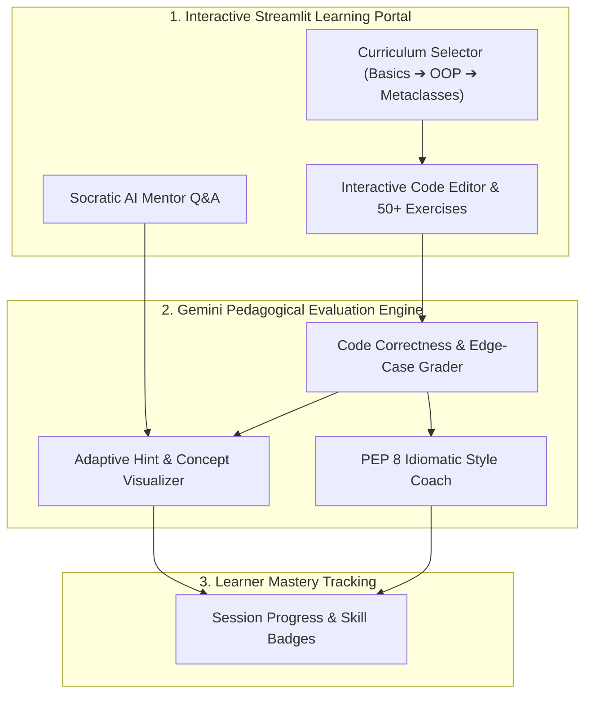

# 🐍 Python Learning Assistant

> **Author & Architect:** [Robina Mirbahar](https://github.com/RobinaMirbahar) (Google Developer Expert in Cloud & AI)  
> **Focus:** Interactive AI-Powered Python Tutor (Variables to Metaclasses & 50+ Hands-On Exercises) with Streamlit & Google Gemini

---

## 🎯 Why I Built Python Learning Assistant (Engineering Purpose & Real-World Value)

### 1. 🐍 Personalized Socratic Mentorship Over Copy-Paste Answers
I built the Python Learning Assistant to guide learners from foundational syntax (`variables`, `loops`) to advanced software engineering (`decorators`, `generators`, `metaclasses`) using adaptive Socratic hints rather than just dumping solutions.

### 2. 🧪 50+ Structured Coding Challenges with Live Feedback
I curated more than 50 progressive exercises where the Gemini-powered evaluator inspects AST structure, edge cases, and PEP 8 style in real time.

### 3. 🌱 Accessible Browser-First Learning Environment
By packaging the tutor in a clean Streamlit interface, students and workshop attendees can practice Python interactively from any laptop or tablet.

---

## 🏗️ System Architecture



---

<div align="center">

[](https://python-learning-assistant.streamlit.app/)
[](https://opensource.org/licenses/MIT)
[](https://python.org)
[](https://aistudio.google.com)
[](https://github.com/RobinaMirbahar/Python-Learning-Assistant/pulls)

**An interactive AI-powered Python tutor — built for all skill levels.**  
Adaptive explanations. Live code examples. Instant feedback. Powered by Google Gemini.

[🌐 Live Demo](https://python-learning-assistant.streamlit.app/) · [🐛 Report Bug](https://github.com/RobinaMirbahar/Python-Learning-Assistant/issues) · [✨ Request Feature](https://github.com/RobinaMirbahar/Python-Learning-Assistant/issues)


</div>

---

## ✨ Features

| Feature | Description |
|---|---|
| 🎯 **Adaptive Learning** | Tailored explanations for beginner, intermediate, and advanced learners |
| 💻 **Interactive Examples** | Run code snippets directly inside the app |
| 📚 **50+ Question Bank** | Pre-loaded with curated Python questions across all skill levels |
| ⚡ **Real-time Feedback** | Instant AI-driven explanations and corrections |
| 🗂️ **Session History** | Progress tracking that persists throughout your learning session |

---

## 🚀 Quick Start

### Prerequisites

- Python **3.10+**
- A free [Gemini API key](https://aistudio.google.com/app/apikey)

### Installation

```bash
# 1. Clone the repository
git clone https://github.com/yourusername/python-learning-assistant.git
cd python-learning-assistant

# 2. Create and activate a virtual environment
python -m venv venv
source venv/bin/activate        # macOS / Linux
.\venv\Scripts\activate         # Windows

# 3. Install dependencies
pip install -r requirements.txt

# 4. Add your API key
echo "GEMINI_API_KEY=your_api_key_here" > .env

# 5. Launch the app
streamlit run python-assistant.py
```

Then open [http://localhost:8501](http://localhost:8501) in your browser. 🎉

---

## 📂 Project Structure

```
PYTHON-LEARNING-ASSISTANT/
├── .devcontainer/          # VSCode dev container configuration
├── .github/                # GitHub Actions workflows
├── venv/                   # Python virtual environment (gitignored)
├── .env                    # Environment variables (gitignored)
├── .gitignore
├── LICENSE
├── python-assistant.py     # Main Streamlit application
├── README.md
└── requirements.txt        # Python dependencies
```

---

## 📚 Sample Questions

<details>
<summary><strong>🟢 Beginner</strong></summary>

- "Explain variables and data types in Python"
- "How do if-else statements work?"
- "What are lists and how do I use them?"

</details>

<details>
<summary><strong>🟡 Intermediate</strong></summary>

- "Explain OOP concepts with a class example"
- "How do I handle file I/O operations?"
- "What are decorators and when should I use them?"

</details>

<details>
<summary><strong>🔴 Advanced</strong></summary>

- "Explain metaclasses with real-world use cases"
- "How can I optimize Python code performance?"
- "Implement a custom context manager"

</details>

---

## 🛠️ Development

### Using the Dev Container (VSCode)

1. Open the project folder in VSCode
2. Press `F1` → select **"Remote-Containers: Reopen in Container"**
3. The environment configures automatically — no manual setup needed

### Dependencies (`requirements.txt`)

```
streamlit>=1.32.0
google-generativeai>=0.3.0
python-dotenv>=1.0.0
```

---

## 🤝 Contributing

Contributions are welcome and appreciated! Here's how to get started:

1. **Fork** this repository
2. **Create** a feature branch: `git checkout -b feature/your-feature-name`
3. **Commit** your changes: `git commit -m 'feat: add your feature'`
4. **Push** to your branch: `git push origin feature/your-feature-name`
5. **Open** a Pull Request

> For major changes, please [open an issue](https://github.com/RobinaMirbahar/Python-Learning-Assistant/issues) first to discuss what you'd like to change.

---

## 📜 License

Distributed under the **MIT License**. See [`LICENSE`](LICENSE) for details.

---

## 🙏 About the Author

<div align="center">

**Robina Mirbahar**  
🏆 Google Cloud Innovator Champion &nbsp;|&nbsp; 👩‍💻 Women Techmakers Ambassador &nbsp;|&nbsp; 🚀 Google Developer Expert

[](https://www.linkedin.com/in/robinamirbahar/)
[](https://twitter.com/robinamirbahar)
[](https://github.com/robinamirbahar)

*If you find this project useful, consider giving it a ⭐ — it helps others discover it too!*

</div>


---

### 🚀 Featured Google Cloud & Agentic AI Portfolio by Robina Mirbahar

| Repository | Architecture & Focus | Live Status |
| :--- | :--- | :--- |
| **[gemma4-multilora-adk-eval](https://github.com/RobinaMirbahar/gemma4-multilora-adk-eval)** | Dynamic Multi-LoRA Hot-Swapping & CI/CD Agent Evaluation (`adk eval`) on Cloud Run GPUs with Gemma 4 & vLLM |   |
| **[slothsre-napops](https://github.com/RobinaMirbahar/slothsre-napops)** | SlothSRE ("NapOps") — Overnight Gemma 4 & Google ADK Incident Digest Agent with OpenTelemetry & Sentry AI Monitoring |   |
| **[streamforge-event-adk](https://github.com/RobinaMirbahar/streamforge-event-adk)** | Real-Time Event-Driven Multi-Agent Pipelines on Google Cloud with ADK (`ParallelAgent` & `LoopAgent`), Eventarc & Pub/Sub |   |
| **[a2a-mcp-mesh-cloudrun](https://github.com/RobinaMirbahar/a2a-mcp-mesh-cloudrun)** | Agent-to-Agent (A2A) & Multi-MCP Mesh on Cloud Run with Gemma 4, Google ADK, Spanner Graph & AlloyDB |   |
| **[cloudguard-gemma-agent](https://github.com/RobinaMirbahar/cloudguard-gemma-agent)** | 6-Part Production Gemma Enterprise Agent Series (ADK, Cloud Run L4 GPU, Firestore, Model Armor, Vertex AI QLoRA) |   |
| **[Comic-Studio-Ai](https://github.com/RobinaMirbahar/Comic-Studio-Ai)** | Multi-Agent Comic Generator powered by Google Gemini API & FastAPI deployed on Google Cloud Run |   |
| **[vertex-ai-imagen3](https://github.com/RobinaMirbahar/vertex-ai-imagen3)** | Generate AI-powered product & editorial images using Google Vertex AI Imagen 3 in Google Colab |   |
| **[Python-Learning-Assistant](https://github.com/RobinaMirbahar/Python-Learning-Assistant)** | AI-powered Python tutor covering 50+ interactive exercises with real-time feedback built with Streamlit + Gemini API |   |
| **[cozy-ai-agent-cafe-game](https://github.com/RobinaMirbahar/cozy-ai-agent-cafe-game)** | Prompt Paws: 60 FPS Cozy AI Agent Bakery Simulation Game teaching RAG, Guardrails, Context Caching & Multi-Agent Loops |   |

<div align="center">
  
</div>

<!-- AUTHOR_SIGNATURE_START -->
---

## 👩‍💻 About the Author

**Robina Mirbahar — Google Cloud & AI Architect**  
*Google Developer Expert (GDE) in Cloud & AI • Published Author • Multi-Agent Systems & Serverless GPU Builder*

[](https://github.com/RobinaMirbahar)
[](https://medium.com/@robinamirbahar)
[](https://dev.to/robinamirbahar)
[](https://www.linkedin.com/in/robina-mirbahar)
[](https://g.dev/RobinaMirbahar)
[](https://www.youtube.com/@RobinaMirbahar)
[](https://x.com/RobinaMirbahar)
[](https://www.amazon.com/dp/B0D146249R)

<!-- AUTHOR_SIGNATURE_END -->
